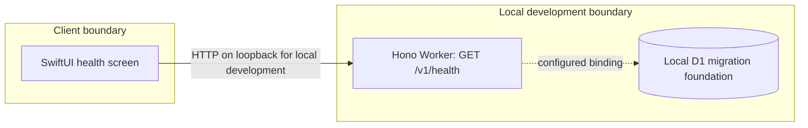
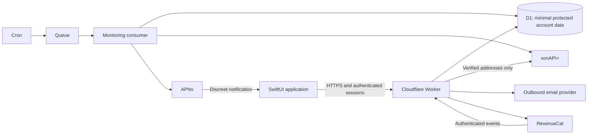

# Architecture

## Implemented foundation

The repository is an npm workspace for a TypeScript API and shared contracts, alongside a native SwiftUI application. The only user-visible interaction is an API health check. D1 has a local migration foundation; no account or breach domain model is implemented.

The health endpoint reports service configuration and checks the local D1 `schema_metadata` bootstrap table. It returns an unavailable response if local migrations have not been applied. It does not query breach providers, validate entitlements or exercise notification delivery.

## Intended product architecture — not implemented

Treat the device, backend, database and each third-party service as separate trust boundaries. The backend must establish identity and ownership before each account-scoped operation; it must also enforce entitlements and quotas independently of the client. Provider keys, email tokens, encryption keys, RevenueCat server keys and APNs signing keys belong only on the server.

Implement identity and a verified scan before billing or monitoring. Keep provider interfaces small and replaceable. Validate external payloads before normalising minimal findings; never infer zero breaches from an upstream error. Introduce database tables with the feature that needs them rather than treating the full specification as an existing schema.

Future Hexproof and Squizz integration boundaries are recorded in the roadmap only. No shared identity, browsing telemetry or integrations runtime exists.
