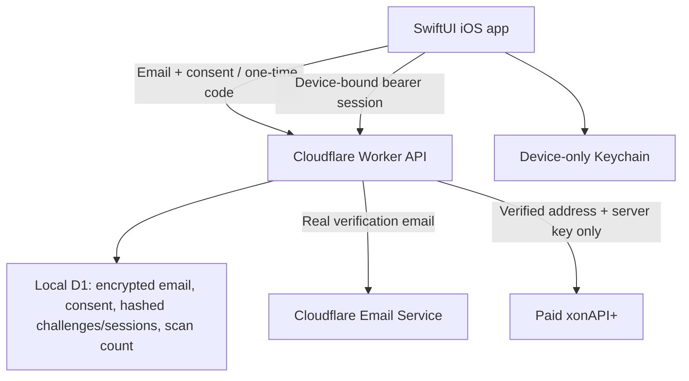

# Architecture

The app has Scan, Addresses, Monitoring and Settings tabs. Authentication and real manual counts are connected. Billing, premium details, monitoring and APNs remain unavailable.

Trust boundaries: the native app supplies email/consent before verification but cannot choose a lookup address after login. A one-time code is sent to the real mailbox and consumed server-side before creating/reusing an account. Every account/address route resolves a user from hashed session and device credentials and checks resource ownership. There is no arbitrary-email scan endpoint or local OTP bypass. Provider failures preserve prior successful counts. Free responses expose only the count, not provider breach details.

Email uses Cloudflare's outbound REST API locally; the adapter can also use its real Workers sending binding. No provider tokens belong in iOS. XON gets a verified address only after consent; the app communicates with the Worker rather than the provider. The backend stores email encrypted with AES-GCM and a separate HMAC lookup value. Detailed metadata is intentionally not fetched in this free slice.

The Worker serves local development and restricted HTTPS staging at `api.cybrguard.app`, with separate D1 and encryption/HMAC keys. Production remains blocked. D1 and the scan rate gate work for manual scans; there is no queue/cron worker yet. Production environment provisioning, provider quota/caching review, billing/monitoring/APNs, scheduled cleanup, retention and key rotation remain release gates. Hexproof/Squizz integration remains future work, with no runtime integration implemented.
